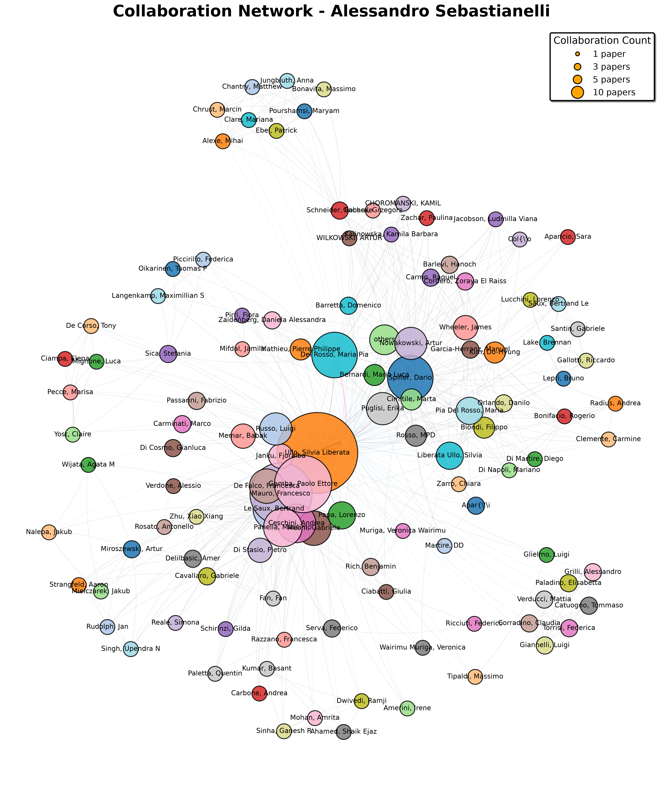


  You can also find my articles on <u><a href="{{author.googlescholar}}">my Google Scholar profile</a>.</u>




I started co-authoring scientific papers since 2018, during these years I collaborated with many researchers

## Books

### Artificial Intelligence Applied to Satellite-based Remote Sensing Data for Earth Observation

> **Editors:**\
> Maria Pia Del Rosso; Alessandro Pia Sebastianelli; Silvia Liberata Ullo\
> Published in 2021\
> 283 pages\
> ISBN: 978-1-83953-212-2\
> e-ISBN: 978-1-83953-213-9\
> https://doi.org/10.1049/PBTE098E

Buy it on: [IET Digital Library](https://digital-library.theiet.org/doi/book/10.1049/pbte098e) or [Amazon](https://www.amazon.it/Artificial-Intelligence-Applied-Satellite-based-Observation/dp/1839532122)

## Papers

### 2026

| apa | year | type | position | url |
|-----|------|------|----------|-----|
|**Sebastianelli, A**, Mauro, F, De Falco, Francesca, Delilbasic, A, Gamba, P, Ullo, S, Panella, Massimo, Cavallaro, G, others (2026) *"Quantum Hardware Benchmarking in The Context of Earth Observation"* *Proceedings of 2026 IEEE International Geoscience and Remote Sensing Symposium*|2026|Conference|1st|-|
|**Sebastianelli, Alessandro**, Mauro, Francesco, Delilbasic, Amer, Di Stasio, Pietro, Fan, Fan, Meoni, Gabriele, Cavallaro, Gabriele, Zhu, Xiao Xiang, Gamba, Paolo, Ullo, Silvia Liberata (2026) *"Quantum Machine Learning for Earth Observation: A review and future prospects"* *IEEE Geoscience and Remote Sensing Magazine*|2026|Journal|1st|-|
|Ceschini, Andrea, Mauro, Francesco, De Falco, Francesca, **Sebastianelli, Alessandro**, Verdone, Alessio, Rosato, Antonello, Le Saux, Bertrand, Panella, Massimo, Gamba, Paolo, Ullo, Silvia L (2026) *"From graphs to qubits: A critical review of quantum graph neural networks"* *Neural Computing and Applications*|2026|Journal|4th|-|
|Corradino, Claudia, Torrisi, Federica, Grilli, Alessandro, Catuogno, Tommaso, Verducci, Mattia, Paladino, Elisabetta, Giannelli, Luigi, **Sebastianelli, Alessandro** (2026) *"Hybrid Quantum CNN for Cross-Sensor Spaceborne Volcanic Thermal Activity Recognition Worldwide"* *arXiv preprint arXiv:2608.00069*|2026|Journal|8th|[url](https://arxiv.org/abs/2608.00069)|
|De Falco, Francesca, Mauro, Francesco, Ceschini, Andrea, **Sebastianelli, Alessandro**, Gamba, Paolo, Ullo, Silvia L, Meoni, Gabriele, Panella, Massimo, Papa, Lorenzo (2026) *"Physics-Driven Latent Diffusion Model for Multispectral Satellite Image Forecasting"* *IEEE Journal of Selected Topics in Applied Earth Observations and Remote Sensing*|2026|Journal|4th|-|
|De Falco, Francesca, Mauro, Francesco, Ceschini, Andrea, **Sebastianelli, Alessandro**, Gamba, Paolo, Ullo, Silvia Liberata, Meoni, Gabriele, Panella, Massimo, Papa, Lorenzo (2026) *"Beyond Conditional Diffusion: A Physics-Guided Diffusion Framework for Joint Forecasting of Physical Drivers and Multispectral Satellite Data"* *Proceedings of the IEEE/CVF Conference on Computer Vision and Pattern Recognition*|2026|Conference|4th|-|
|Janku, Fjoralba, Mauro, Francesco, Russo, Luigi, Memar, Babak, **Sebastianelli, Alessandro**, Gamba, Paolo, Ullo, Silvia Liberata (2026) *"Cross-City Transfer Learning for Sentinel-5P-Driven NO 2 Prediction in Data-Sparse Urban Environments"* *ISPRS Annals of the Photogrammetry, Remote Sensing and Spatial Information Sciences*|2026|Journal|5th|-|
|Janku, Fjoralba, Mauro, Francesco, Russo, Luigi, Memar, Babak, **Sebastianelli, Alessandro**, Gamba, Paolo, Ullo, Silvia Liberata (2026) *"Improving Cross-City $ NO\_ $\{$2$\"* *IEEE Journal of Selected Topics in Applied Earth Observations and Remote Sensing*|2026|Journal|5th|-|
|Mauro, Francesco, **Sebastianelli, Alessandro**, Gamba, Paolo, Ullo, Silvia L (2026) *"Quantum-Inspired Feature Extraction for Earth Observation: The Quanv4eo Framework"* *IGARSS 2026-2026 IEEE International Geoscience and Remote Sensing Symposium*|2026|Conference|2nd|-|
|Mauro, Francesco, De Falco, Francesca, Papa, Lorenzo, Ceschini, Andrea, **Sebastianelli, Alessandro**, Gamba, Paolo, Panella, Massimo, Ullo, Silvia (2026) *"Enriching Earth Observation labeled data with Quantum Conditioned Diffusion Models"* *IEEE Transactions on Geoscience and Remote Sensing*|2026|Journal|5th|-|
|Miroszewski, Artur, Nalepa, Jakub, Wijata, Agata M, Mielczarek, Jakub, Le Saux, Bertrand, **Sebastianelli, Alessandro** (2026) *"Quo Vadis, Quantum Machine Learning?: Quantum kernel methods meet Earth observation"* *IEEE Geoscience and Remote Sensing Magazine*|2026|Journal|6th|-|
|Roca-Barcel{\'o (2026) *"A satellite based machine learning approach for estimating high resolution daily average air temperature in a megacity in Brazil"* *Scientific Reports*|2026|Journal|-|-|
|Torrisi, Federica, Corradino, Claudia, Grilli, Alessandro, Catuogno, Tommaso, Verducci, Mattia, Paladino, Elisabetta, Giannelli, Luigi, **Sebastianelli, Alessandro** (2026) *"Volcanic Clouds Detection through QCNN and Geostationary Satellite Multispectral Imagery"* *arXiv preprint arXiv:2608.00072*|2026|Journal|8th|[url](https://arxiv.org/abs/2608.00072)|

### 2025

| apa | year | type | position | url |
|-----|------|------|----------|-----|
|**Sebastianelli, Alessandro**, Mauro, Francesco, Ciabatti, Giulia, Spiller, Dario, Le Saux, Bertrand, Gamba, Paolo, Ullo, Silvia (2025) *"Quanv4eo: Empowering earth observation by means of quanvolutional neural networks"* *IEEE Transactions on Geoscience and Remote Sensing*|2025|Journal|1st|-|
|Barretta, Domenico, Papa, Lorenzo, Meoni, Gabriele, **Sebastianelli, Alessandro** (2025) *"First Evaluation of Hybrid Quantum Neural Networks for Vessel Classification in Raw Multispectral Imagery"* *IGARSS 2025-2025 IEEE International Geoscience and Remote Sensing Symposium*|2025|Conference|4th|-|
|Cavallaro, Gabriele, Singh, Upendra N, Miroszewski, Artur, Rudolph, Jan, Strangfeld, Aaron, **Sebastianelli, Alessandro**, Mauro, Francesco, Delilbasic, Amer (2025) *"QUEST: a new technical committee for Quantum Earth Science and technology [Technical Committees]"*|2025|Journal|6th|-|
|Ceschini, Andrea, Carbone, Andrea, **Sebastianelli, Alessandro**, Panella, Massimo, Le Saux, Bertrand (2025) *"On hybrid quanvolutional neural networks optimization"* *Quantum Machine Intelligence*|2025|Journal|3rd|-|
|De Falco, Francesca, Mauro, Francesco, Ceschini, Andrea, **Sebastianelli, Alessandro**, Gamba, Paolo E, Ullo, Silvia L, Panella, Massimo (2025) *"Leveraging quantum latent diffusion models for data augmentation on the eurosat dataset"* *IGARSS 2025-2025 IEEE International Geoscience and Remote Sensing Symposium*|2025|Conference|4th|-|
|Mauro, F, De Falco, F, Papa, L, Ceschini, A, **Sebastianelli, A**, Meoni, G, Panella, M, Gamba, P, Ullo, SL, others (2025) *"Quantum Diffusion Models in Earth Observation"* *Proc. of Quantum Technology Conference (QTC 2025)*|2025|Conference|5th|-|
|Mauro, Francesco, De Falco, Francesca, Ceschini, Andrea, Meoni, Gabriele, **Sebastianelli, Alessandro**, Panella, Massimo, Gamba, Paolo E, Ullo, Silvia L (2025) *"Advancing Earth Observation with Trainable Quanvolutional Neural Networks for Classification Tasks"* *IGARSS 2025-2025 IEEE International Geoscience and Remote Sensing Symposium*|2025|Conference|5th|-|
|Mauro, Francesco, Razzano, Francesca, Di Stasio, Pietro, **Sebastianelli, Alessandro**, Meoni, Gabriele, Schirinzi, Gilda, Gamba, Paolo, Ullo, Silvia Liberata (2025) *"Quantum-Enhanced Water Quality Monitoring: Exploiting $$\backslash$Phi $ Sat-2 Data With Quanvolution"* *IEEE Geoscience and Remote Sensing Letters*|2025|Journal|4th|-|
|Russo, Luigi, Mauro, Francesco, **Sebastianelli, Alessandro**, Gamba, Paolo, Ullo, Silvia Liberata (2025) *"An end-to-end framework for multimodal and multitemporal analysis of water bodies using the SEN12-WATER dataset"* *IEEE Journal of Selected Topics in Applied Earth Observations and Remote Sensing*|2025|Journal|3rd|-|
|Russo, Luigi, Mauro, Francesco, Memar, Babak, **Sebastianelli, Alessandro**, Ullo, Silvia L, Gamba, Paolo (2025) *"A quantum-assisted attention U-Net for building segmentation over Tunis using Sentinel-1 data"* *2025 joint urban remote sensing event (JURSE)*|2025|Book-ch|4th|-|
|Serva, Federico, **Sebastianelli, Alessandro**, Le Saux, Bertrand, Ricciuti, Federico (2025) *"MUMUCD: a multimodal multiclass change detection dataset"* *IEEE Geoscience and Remote Sensing Letters*|2025|Journal|2nd|-|

### 2024

| apa | year | type | position | url |
|-----|------|------|----------|-----|
|**Sebastianelli, Alessandro**, Serva, Federico, Ceschini, Andrea, Paletta, Quentin, Panella, Massimo, Le Saux, Bertrand (2024) *"Machine learning forecast of surface solar irradiance from meteo satellite data"* *Remote Sensing of Environment*|2024|Journal|1st|-|
|**Sebastianelli, Alessandro**, Spiller, Dario, Carmo, Raquel, Wheeler, James, Nowakowski, Artur, Jacobson, Ludmilla Viana, Kim, Dohyung, Barlevi, Hanoch, Cordero, Zoraya El Raiss, Col{\'o (2024) *"A reproducible ensemble machine learning approach to forecast dengue outbreaks"* *Scientific reports*|2024|Journal|1st|-|
|De Falco, Francesca, Ceschini, Andrea, **Sebastianelli, Alessandro**, Le Saux, Bertrand, Panella, Massimo (2024) *"Quantum hybrid diffusion models for image synthesis"* *KI-K{\"u*|2024|Journal|3rd|-|
|De Falco, Francesca, Ceschini, Andrea, **Sebastianelli, Alessandro**, Le Saux, Bertrand, Panella, Massimo (2024) *"Quantum latent diffusion models"* *Quantum Machine Intelligence*|2024|Journal|3rd|-|
|Ebel, Patrick, Schneider, Rochelle, Bonavita, Massimo, Clare, Mariana, Jungbluth, Anna, Pourshamsi, Maryam, Chantry, Matthew, Alexe, Mihai, **Sebastianelli, Alessandro**, Chrust, Marcin (2024) *"2024 ESA-ECMWF workshop report: current status, progress and opportunities in machine learning for Earth system observation and prediction"* *npj Climate and Atmospheric Science*|2024|Journal|9th|-|
|Mauro, Francesco, **Sebastianelli, Alessandro**, Del Rosso, Maria Pia, Gamba, Paolo, Ullo, Silvia Liberata (2024) *"Qspecklefilter: A quantum machine learning approach for sar speckle filtering"* *IGARSS 2024-2024 IEEE International Geoscience and Remote Sensing Symposium*|2024|Conference|2nd|-|
|Mauro, Francesco, **Sebastianelli, Alessandro**, Le Saux, Bertrand, Gamba, Paolo, Ullo, Silvia Liberata (2024) *"A hybrid MLP-quantum approach in graph convolutional neural networks for Oceanic Ni{\~n"* *IGARSS 2024-2024 IEEE International Geoscience and Remote Sensing Symposium*|2024|Conference|2nd|-|
|Nowakowski, Artur, Del Rosso, Maria Pia, Zachar, Paulina, Spiller, Dario, Gabara, Grzegorz, Barretta, Domenico, Kalinowska, Kamila Barbara, Choroma{\'n (2024) *"Transfer learning in earth observation data analysis: a review"* *IEEE Geoscience and Remote Sensing Magazine*|2024|Journal|-|-|
|Papa, Lorenzo, **Sebastianelli, Alessandro**, Meoni, Gabriele, Amerini, Irene (2024) *"On the impact of key design aspects in simulated hybrid quantum neural networks for Earth observation"* *arXiv preprint arXiv:2410.08677*|2024|Journal|2nd|[url](https://arxiv.org/abs/2410.08677)|
|Reale, Simona, Di Stasio, Pietro, Mauro, Francesco, **Sebastianelli, Alessandro**, Gamba, Paolo, Ullo, Silvia Liberata (2024) *"Benchmarking of a new data splitting method on volcanic eruption data"* *arXiv preprint arXiv:2410.06306*|2024|Journal|4th|[url](https://arxiv.org/abs/2410.06306)|
|Russo, Luigi, Mauro, Francesco, **Sebastianelli, Alessandro**, Gamba, Paolo, Ullo, Silvia Liberata (2024) *"SEN12-WATER: A new dataset for hydrological applications and its benchmarking"* *arXiv preprint arXiv:2409.17087*|2024|Journal|3rd|[url](https://arxiv.org/abs/2409.17087)|
|Russo, Luigi, Mauro, Francesco, Memar, Babak, **Sebastianelli, Alessandro**, Gamba, Paolo, Ullo, Silvia Liberata (2024) *"Using Multi-Temporal Sentinel-1 and Sentinel-2 data for water bodies mapping"* *IGARSS 2024-2024 IEEE International Geoscience and Remote Sensing Symposium*|2024|Conference|4th|-|

### 2023

| apa | year | type | position | url |
|-----|------|------|----------|-----|
|**Sebastianelli, Alessandro**, Del Rosso, Maria Pia, Ullo, Silvia Liberata, Gamba, Paolo (2023) *"On quantum hyperparameters selection in hybrid classifiers for earth observation data"* *IEEE Geoscience and Remote Sensing Letters*|2023|Journal|1st|-|
|Mauro, Francesco, Rich, Benjamin, Muriga, Veronica Wairimu, Janku, Fjoralba, **Sebastianelli, Alessandro**, Ullo, Silvia Liberata (2023) *"SEN2DWATER: A novel multispectral and multitemporal dataset and deep learning benchmark for water resources analysis"* *IGARSS 2023-2023 IEEE International Geoscience and Remote Sensing Symposium*|2023|Conference|5th|-|
|Mauro, Francesco, Russo, Luigi, Janku, Fjoralba, **Sebastianelli, Alessandro**, Ullo, Silvia Liberata (2023) *"Estimation of ground NO2 measurements from Sentinel-5P tropospheric data through categorical boosting"* *2023 IEEE International Conference on Metrology for eXtended Reality, Artificial Intelligence and Neural Engineering (MetroXRAINE)*|2023|Conference|4th|-|
|Spiller, Dario, Santin, Gabriele, **Sebastianelli, Alessandro**, Lucchini, Lorenzo, Gallotti, Riccardo, Lake, Brennan, Ullo, Silvia Liberata, Saux, Bertrand Le, Lepri, Bruno (2023) *"Analysis of COVID-19 first wave in the US based on demographic, mobility, and environmental variables"* *arXiv preprint arXiv:2302.14649*|2023|Journal|3rd|[url](https://arxiv.org/abs/2302.14649)|
|Tom{\'a (2023) *"Deep unfolding for hypersharpening using a high-frequency injection module"* *Proceedings of the IEEE/CVF Conference on Computer Vision and Pattern Recognition (CVPR)*|2023|Conference|-|-|
|Ullo, Silvia Liberata, Mauro, Francesco, **Sebastianelli, Alessandro**, Le Saux, Bertrand, Gamba, Paolo Ettore (2023) *"Enhancing Earth Observation with Hybrid Quantum Neural Networks"* *AGU Fall Meeting Abstracts*|2023|Book-ch|3rd|-|
|Wairimu Muriga, Veronica, Rich, Benjamin, Mauro, Francesco, **Sebastianelli, Alessandro**, Liberata Ullo, Silvia (2023) *"A Machine Learning Approach to Long-Term Drought Prediction using Normalized Difference Indices Computed on a Spatiotemporal Dataset"* *arXiv e-prints*|2023|Journal|4th|-|

### 2022

| apa | year | type | position | url |
|-----|------|------|----------|-----|
|**Sebastianelli, Alessandro**, Del Rosso, Maria Pia, Ullo, Silvia L, Gamba, Paolo (2022) *"A speckle filter for Sentinel-1 SAR ground range detected data based on residual convolutional neural networks"* *IEEE Journal of Selected Topics in Applied Earth Observations and Remote Sensing*|2022|Journal|1st|-|
|**Sebastianelli, Alessandro**, Mauro, Francesco, Di Cosmo, Gianluca, Passarini, Fabrizio, Carminati, Marco, Ullo, Silvia Liberata (2022) *"A Decision Support System Based on Machine Learning to Counteract Covid-Like Pandemic Events"* *IGARSS 2022-2022 IEEE International Geoscience and Remote Sensing Symposium*|2022|Conference|1st|-|
|**Sebastianelli, Alessandro**, Puglisi, Erika, Del Rosso, Maria Pia, Mifdal, Jamila, Nowakowski, Artur, Mathieu, Pierre Philippe, Pirri, Fiora, Ullo, Silvia Liberata (2022) *"PLFM: Pixel-level merging of intermediate feature maps by disentangling and fusing spatial and temporal data for cloud removal"* *IEEE transactions on geoscience and remote sensing*|2022|Journal|1st|-|
|Del Rosso, Maria Pia, **Sebastianelli, Alessandro**, Spiller, Dario, Ullo, Silvia Liberata (2022) *"A demo setup testing onboard CNNs for Volcanic Eruption Detection"* *2022 IEEE International Conference on Metrology for Extended Reality, Artificial Intelligence and Neural Engineering (MetroXRAINE)*|2022|Conference|2nd|-|
|Di Stasio, Pietro, **Sebastianelli, Alessandro**, Meoni, Gabriele, Ullo, Silvia Liberata (2022) *"Early detection of volcanic eruption through artificial intelligence on board"* *2022 IEEE International Conference on Metrology for Extended Reality, Artificial Intelligence and Neural Engineering (MetroXRAINE)*|2022|Conference|2nd|-|

### 2021

| apa | year | type | position | url |
|-----|------|------|----------|-----|
|**Sebastianelli, Alessandro**, Del Rosso, Maria Pia, Mathieu, Pierre Philippe, Ullo, Silvia Liberata (2021) *"Paradigm selection for data fusion of sar and multispectral sentinel data applied to land-cover classification"* *arXiv preprint arXiv:2106.11056*|2021|Journal|1st|[url](https://arxiv.org/abs/2106.11056)|
|**Sebastianelli, Alessandro**, Del Rosso, Maria Pia, Ullo, Silvia Liberata (2021) *"Automatic dataset builder for machine learning applications to satellite imagery"* *SoftwareX*|2021|Journal|1st|-|
|**Sebastianelli, Alessandro**, Liberata Ullo, Silvia, Pia Del Rosso, Maria, Apar{\'\i (2021) *"Principles of satellite data analysis"*|2021|Book-ch|1st|-|
|**Sebastianelli, Alessandro**, Mauro, Francesco, Di Cosmo, Gianluca, Passarini, Fabrizio, Carminati, Marco, Ullo, Silvia Liberata (2021) *"Airsense-to-act: A concept paper for covid-19 countermeasures based on artificial intelligence algorithms and multi-source data processing"* *ISPRS International Journal of Geo-Information*|2021|Journal|1st|-|
|**Sebastianelli, Alessandro**, Pia Del Rosso, Maria, Liberata Ullo, Silvia, Puglisi, Erika, Biondi, Filippo (2021) *"A generation problem"*|2021|Book-ch|1st|-|
|**Sebastianelli, Alessandro**, Pia Del Rosso, Maria, Liberata Ullo, Silvia, Radius, Andrea, Clemente, Carmine, Orlando, Danilo, Biondi, Filippo, Wheeler, James (2021) *"A filtering problem: SAR speckle filtering"*|2021|Book-ch|1st|-|
|**Sebastianelli, Alessandro**, Pia Del Rosso, Maria, Zarro, Chiara, Di Martire, Diego, Di Napoli, Mariano, Spiller, Dario, Nowakowski, Artur, Bonifacio, Rogerio, Kim, Do-Hyung, Garcia-Herranz, Manuel (2021) *"A classification problem"*|2021|Book-ch|1st|-|
|**Sebastianelli, Alessandro**, Tipaldi, Massimo, Ullo, Silvia Liberata, Glielmo, Luigi (2021) *"A Deep Q-Learning based approach applied to the Snake game"* *2021 29th Mediterranean Conference on Control and Automation (MED)*|2021|Conference|1st|-|
|**Sebastianelli, Alessandro**, Zaidenberg, Daniela Alessandra, Spiller, Dario, Le Saux, Bertrand, Ullo, Silvia Liberata (2021) *"On circuit-based hybrid quantum neural networks for remote sensing imagery classification"* *IEEE Journal of Selected Topics in Applied Earth Observations and Remote Sensing*|2021|Journal|1st|-|
|Del Rosso, Maria Pia, **Sebastianelli, Alessandro**, Aparicio, Sara, Wheeler, James (2021) *"How to create a proper EO dataset"* *Artificial Intelligence Applied to Satellite-based Remote Sensing Data for Earth Observation*|2021|Journal|2nd|-|
|Del Rosso, Maria Pia, **Sebastianelli, Alessandro**, Spiller, Dario, Mathieu, Pierre Philippe, Ullo, Silvia Liberata (2021) *"On-board volcanic eruption detection through cnns and satellite multispectral imagery"* *Remote Sensing*|2021|Journal|2nd|-|
|Del Rosso, Maria Pia, **Sebastianelli, Alessandro**, Ullo, Silvia Liberata, others (2021) *"Artificial intelligence applied to satellite-based remote sensing data for earth observation"*|2021|Journal|2nd|-|
|Rosso, MPD, Ullo, Silvia Liberata, **Sebastianelli, Alessandro**, Spiller, Dario, Puglisi, Erika, Biondi, Filippo, Orlando, Danilo, others (2021) *"Artificial neural network"* *Artificial intelligence applied to satellite-based remote sensing data for earth observation*|2021|Book-ch|3rd|-|
|Rosso, MPD, Ullo, Silvia Liberata, **Sebastianelli, Alessandro**, Spiller, Dario, Puglisi, Erika, Martire, DD, Apar{\'\i (2021) *"Artificial intelligence, machine learning and deep learning"* *Artificial Intelligence Applied to Satellite-Based Remote Sensing Data for Earth Observation*|2021|Book-ch|3rd|-|
|Schneider, Rochelle, **Sebastianelli, Alessandro**, Spiller, Dario, Wheeler, James, Carmo, Raquel, Nowakowski, Artur, Garcia-Herranz, Manuel, Kim, Dohyung, Barlevi, Hanoch, Cordero, Zoraya El Raiss, others (2021) *"Climate-based ensemble machine learning model to forecast Dengue epidemics (papers track)"* *Thirty-eighth International Conference on Machine Learning (ICML) 2021*|2021|Conference|2nd|-|
|Ullo, Silvia Liberata, **Sebastianelli, Alessandro**, Rosso, MPD, Spiller, Dario, Puglisi, Erika, Nowakowski, Artur, Bernardi, Mario Luca, Cimitile, Marta, others (2021) *"Convolutional neural networks"* *Artificial Intelligence Applied to Satellite-based Remote Sensing Data for Earth Observation*|2021|Book-ch|2nd|-|
|Ullo, Silvia Liberata, Del Rosso, Maria Pia, **Sebastianelli, Alessandro**, Puglisi, Erika, Bernardi, Mario Luca, Cimitile, Marta, others (2021) *"How to develop your network with Python and Keras"* *Artificial Intelligence Applied to Satellite-based Remote Sensing Data for Earth Observation*|2021|Book-ch|3rd|-|
|Ullo, Silvia Liberata, Mohan, Amrita, **Sebastianelli, Alessandro**, Ahamed, Shaik Ejaz, Kumar, Basant, Dwivedi, Ramji, Sinha, Ganesh R (2021) *"A new mask R-CNN-based method for improved landslide detection"* *IEEE Journal of Selected Topics in Applied Earth Observations and Remote Sensing*|2021|Journal|3rd|-|
|Zaidenberg, Daniela A, **Sebastianelli, Alessandro**, Spiller, Dario, Le Saux, Bertrand, Ullo, Silvia Liberata (2021) *"Advantages and bottlenecks of quantum machine learning for remote sensing"* *2021 IEEE International Geoscience and Remote Sensing Symposium IGARSS*|2021|Conference|2nd|-|

### 2020

| apa | year | type | position | url |
|-----|------|------|----------|-----|
|De Corso, Tony, Mignone, Luca, **Sebastianelli, Alessandro**, del Rosso, Maria P, Yost, Claire, Ciampa, Elena, Pecce, Marisa, Sica, Stefania, Ullo, Silvia (2020) *"Application of DInSAR technique to high coherence satellite images for strategic infrastructure monitoring"* *IGARSS 2020-2020 IEEE International Geoscience and Remote Sensing Symposium*|2020|Conference|3rd|-|

### 2019

| apa | year | type | position | url |
|-----|------|------|----------|-----|
|Ullo, Silvia Liberata, Langenkamp, Maximillian S, Oikarinen, Tuomas P, Del Rosso, Maria Pia, **Sebastianelli, Alessandro**, Piccirillo, Federica, Sica, Stefania (2019) *"Landslide geohazard assessment with convolutional neural networks using sentinel-2 imagery data"* *IGARSS 2019-2019 IEEE International Geoscience and Remote Sensing Symposium*|2019|Conference|5th|-|

### 2018

| apa | year | type | position | url |
|-----|------|------|----------|-----|
|Di Martire, Diego, Confuorto, Pierluigi, Frezza, Annalisa, Ramondini, Massimo, L{\`o (2018) *"X-and C-band SAR data to monitoring ground deformations and slow-moving landslides for the 2016 Manta and Portoviejo earthquake (Manabi, Ecuador)"* *2018 IEEE international conference on environmental engineering (EE)*|2018|Conference|-|-|
|Ullo, SL, Angelino, CV, Cicala, L, Fiscante, N, Addabbo, P, Del Rosso, MP, **Sebastianelli, A** (2018) *"SAR interferometry with open Sentinel-1 data for environmental measurements: the case of Ischia earthquake"* *2018 IEEE international conference on environmental engineering (EE)*|2018|Conference|7th|-|

